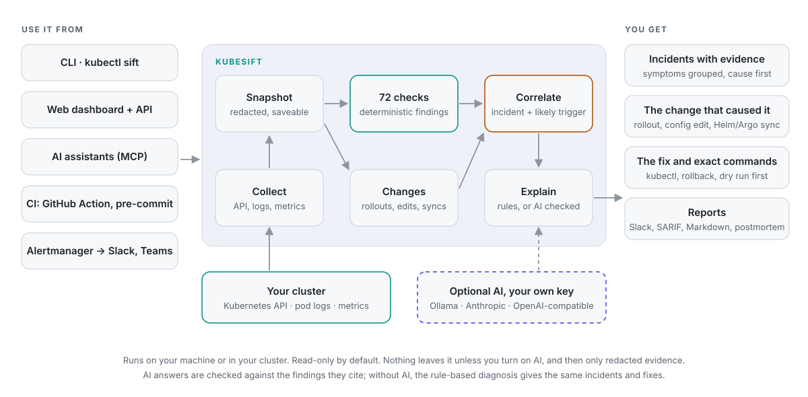

<p align="center"></p>

# KubeSift

**Find out what is broken in Kubernetes, why, and what changed — in one command.**

[](https://pypi.org/project/kubesift/)
[](https://github.com/OpeyemiAdeniji/KubeSift/actions/workflows/ci.yml)
[](LICENSE)

[Website](https://opeyemiadeniji.github.io/KubeSift/) · [Quick start](#quick-start) · [Docs](https://opeyemiadeniji.github.io/KubeSift/docs/) · [Production guide](docs/production.md)

KubeSift reads your cluster, runs 72 deterministic checks, links each failure to the change that most likely
caused it (a rollout, a ConfigMap edit, a Helm upgrade, a node going away) and tells you the fix, with the
exact commands. An LLM is optional: it ranks and explains the evidence, it never invents it.


<sub>Real output on the demo cluster used by the tests (`python scripts/gen_readme_image.py`).</sub>

## Quick start

You need Python 3.10 or newer and a cluster that `kubectl` can reach. KubeSift only reads; it never changes
the cluster unless you run `kubesift fix` and confirm.

1. **Install.**

   ```bash
   pipx install "kubesift[all]"
   ```

   No pipx? `python -m pip install --user pipx && python -m pipx ensurepath`, then open a new terminal.
   `pip install "kubesift[all]"` in a virtualenv works too.
   No Python at all? Download the standalone `kubectl-sift` for your OS from
   [Releases](https://github.com/OpeyemiAdeniji/KubeSift/releases/latest) ([how](docs/krew.md)).

2. **Check that kubectl reaches your cluster.** KubeSift uses the same kubeconfig and current context.

   ```bash
   kubectl get nodes
   ```

   No cluster yet? [kind](https://kind.sigs.k8s.io/) makes a local one in a minute (needs Docker):
   `kind create cluster`.

3. **Check the setup.** Connection, read permissions, metrics and AI configuration, with a fix for anything missing.

   ```bash
   kubectl sift doctor
   ```

4. **Find what is broken.** All namespaces, or one with `-n`; `-v` adds evidence and recent changes.

   ```bash
   kubectl sift diagnose
   kubectl sift diagnose -n shop -v
   kubectl sift ask "why is checkout failing?"
   ```

5. **Practise on a safe failure** (optional). A drill breaks a separate `kubesift-drill` namespace on purpose:

   ```bash
   kubectl sift drill start crashloop --yes
   kubectl sift diagnose -n kubesift-drill
   kubectl sift drill reveal crashloop
   kubectl sift drill stop
   ```

6. **Add AI explanations** (optional). Everything above works without it.
   `export ANTHROPIC_API_KEY=...` (or `OPENAI_API_KEY`, `OPENROUTER_API_KEY`, or a local
   [Ollama](#ai-is-optional-and-careful) model), then run `kubectl sift doctor` again.

`kubesift` and `kubectl sift` are the same command.

## Why

Most incidents follow a change, and most of the time goes into *finding* the cause: jumping between kubectl,
dashboards, logs, Git and chat. KubeSift answers the on-call questions directly:

- **What is broken?** Crash loops (with exit-code and log-based explanations), OOM kills, image pulls
  (including Docker Hub rate limits), pending pods (with the scheduler's real reason), missing ConfigMaps/Secrets,
  Services with no endpoints or the wrong port, dead nodes, unbound volumes, failing Jobs and CronJobs,
  autoscalers that can't scale, broken DNS, NetworkPolicies that block DNS, down admission webhooks that block
  deploys, pod IP exhaustion, expiring certificates, and apps refused access (Kubernetes RBAC told apart from
  cloud IAM, admission policies, quotas and LimitRanges, with the exact `kubectl auth can-i` check).
- **Why, and what changed?** Rollout diffs (image, env, resources, probes), config edits, Helm releases,
  Argo CD syncs, scaling and node events — linked to the problems they caused, with rollback commands.
- **What will hurt next?** Removed APIs for your next upgrade, PDBs that will hang node drains, retired
  ingress-nginx, containerd 1.x and cgroup v1 nodes, kubelet skew, missing probes and limits, privileged
  containers, plaintext secrets in env, single replicas.
- **What is it costing?** Over-requested CPU/memory with right-sizing values from real usage, idle GPUs,
  unused volumes and idle load balancers.

## How it works

<picture>
  <source media="(prefers-color-scheme: dark)" srcset="docs/images/architecture-dark.svg">
  
</picture>

More detail: [architecture](docs/architecture.md).

## Run it in the cluster

A Helm chart runs the dashboard, REST API, shared MCP endpoint, Alertmanager receiver and background scans
that post to Slack or Teams. Images and charts are signed; for high availability (2+ replicas on PostgreSQL)
see [docs/production.md](docs/production.md):

```bash
helm install kubesift oci://ghcr.io/opeyemiadeniji/charts/kubesift -n kubesift --create-namespace \
  --set llm.provider=anthropic --set llm.anthropicApiKey=$ANTHROPIC_API_KEY \
  --set notifications.slackWebhookUrl=$SLACK_WEBHOOK
```

## Use it

| Command | What it does |
|---|---|
| `kubesift diagnose [-n ns] [-v] [--risks]` | Scan, group problems into incidents, explain causes |
| `kubesift ask "why is checkout failing?"` | Plain-English questions, focused on the resources you name |
| `kubesift changes --since 2h` | What changed: rollouts with diffs, config edits, Helm, Argo CD, scaling, nodes |
| `kubesift explain deploy/checkout -n shop` | Everything about one resource: status, pods, events, logs, findings, changes |
| `kubesift audit` | Production-readiness review (reliability, security, resources, upgrade risks) |
| `kubesift upgrade-check --target 1.36` | Blockers for the next Kubernetes version |
| `kubesift cost` | Right-sizing and waste, with monthly savings |
| `kubesift lint ./k8s -t 1.36` | Check manifests, Helm charts or Kustomize dirs before they ship (no cluster needed) |
| `kubesift preflight k8s/ -n prod` | **Before deploy:** check a change against the live cluster (missing Secrets, capacity, OOM risk, risky diffs, webhook rejections) |
| `kubesift diff --since 2h` | **Time travel:** what is different between now and two hours ago |
| `kubesift postmortem -n shop` | **After:** draft a blameless postmortem with timeline, root cause and action items |
| `kubesift drill start crashloop` | **Practise:** break a drill namespace on purpose to train on-call |
| `kubesift knowledge export` / `import` | Share what fixed past incidents between teams and clusters |
| `kubesift fix rollback deployment/checkout -n shop` | Guarded fix: plan → server-side dry run → confirm → audit log |
| `kubesift snapshot save` | Redacted snapshot to analyse later with `--from` (judged as of when it was taken) or attach to a ticket |
| `kubesift note add pod-oomkilled "Raised to 1Gi; leak fixed in 3.3"` | Team memory, shown next to matching findings |
| `kubesift history` | Past investigations |
| `kubesift serve` | Web dashboard and REST API |
| `kubesift mcp` | MCP server for Claude, Cursor, VS Code and other assistants |

Every command takes `-o json`; `diagnose` and `lint` also take `-o markdown` (paste into a ticket or postmortem)
and `lint` takes `-o sarif` (GitHub code scanning). `--fail-on high` makes CI fail on findings.

## Where it fits

- **On call:** `kubectl sift diagnose -n <ns> -v` or ask your AI assistant through MCP ([docs/mcp.md](docs/mcp.md)).
- **Alerts:** point Alertmanager at `/api/v1/webhooks/alertmanager`; KubeSift investigates the alert's namespace
  and posts the diagnosis to Slack/Teams before anyone opens a laptop.
- **Slack:** `/sift diagnose shop`, `/sift why checkout`, `/sift changes`, with a "Roll back (dry run)" button
  ([docs/slack.md](docs/slack.md)).
- **CI:** stop problems before they ship. `kubesift preflight` checks the change against the real cluster
  ([docs/preflight.md](docs/preflight.md)); `kubesift lint` needs no cluster.

  ```yaml
  - uses: OpeyemiAdeniji/KubeSift@v2
    with: {paths: k8s/, target-version: "1.36", fail-on: high}
  ```

  or as a pre-commit hook (`id: kubesift-lint`).
- **Upgrades and FinOps:** `upgrade-check` before every version bump; `cost` monthly.

## AI is optional, and careful

| Provider | Setup |
|---|---|
| Anthropic | `export ANTHROPIC_API_KEY=...` (default model `claude-opus-5-5`; `pip install "kubesift[anthropic]"`) |
| OpenAI / OpenRouter | `export OPENAI_API_KEY=...` or `OPENROUTER_API_KEY=...` |
| Local (Ollama, vLLM) | `export KUBESIFT_LLM_PROVIDER=ollama KUBESIFT_LLM_MODEL=llama3.1` (without a GPU expect minutes per answer; raise `KUBESIFT_LLM_TIMEOUT`) |
| None | Works fully on rules: `--no-llm` or `KUBESIFT_LLM_PROVIDER=none` |

- Secret and ConfigMap **values are never kept**: they are reduced to key names the moment they are read, and
  certificates to their expiry date.
- Tokens, passwords, API keys, connection-string credentials and emails are redacted from logs before they are
  stored or sent. `send_logs_to_llm: false` keeps logs out of prompts entirely.
- LLM answers must cite real findings; uncited claims are capped at 40% confidence. Any LLM failure falls back
  to the rule-based diagnosis. `python scripts/eval_ai.py --provider <name>` scores a model on the demo cluster
  (does it find the real causes, does it cite real evidence) before you rely on it.
- Read-only by default. Fixes need an explicit confirmation (CLI) or `allow_writes` (server/MCP), always run a
  server-side dry run first and are written to an audit log.

## Docs

- [All checks](docs/checks.md) · [Configuration](docs/configuration.md) · [MCP setup](docs/mcp.md) ·
  [Standalone binary and krew](docs/krew.md) ·
  [Preflight](docs/preflight.md) · [Slack](docs/slack.md) · [Production deployment](docs/production.md) · [Architecture](docs/architecture.md) ·
  [Releasing](docs/releasing.md) · [Contributing](CONTRIBUTING.md) · [Security](SECURITY.md)

## License

[Apache-2.0](LICENSE)

## Develop

```bash
pip install -e ".[dev]"
pytest                          # unit tests on a synthetic broken cluster
./scripts/e2e.sh                # breaks a kind cluster on purpose and checks every failure is explained
python scripts/eval_ai.py --provider anthropic   # grades an LLM's explanations (needs its API key)
```
