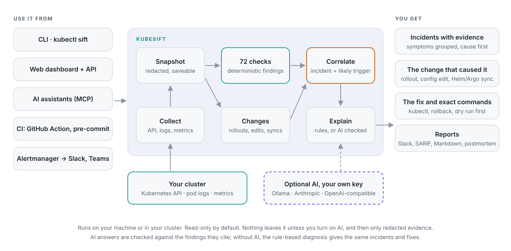

# KubeSift documentation

KubeSift finds what is broken in a Kubernetes cluster, links each problem to the change that most likely caused it
(a rollout, a ConfigMap or Secret edit, a Helm upgrade, an Argo CD sync, a node going away) and tells you the fix,
with the evidence and the exact commands. It is read-only by default and works without an AI key.

<picture>
  <source media="(prefers-color-scheme: dark)" srcset="images/architecture-dark.svg">
  
</picture>

## Install

=== "pipx (recommended)"

    ```bash
    pipx install "kubesift[all]"
    ```

=== "pip"

    ```bash
    pip install "kubesift[all]"
    ```

=== "No Python"

    Download the standalone `kubectl-sift` for your OS from the
    [latest release](https://github.com/OpeyemiAdeniji/KubeSift/releases/latest).
    See [Standalone binary and krew](krew.md).

=== "In the cluster (Helm)"

    ```bash
    helm install kubesift oci://ghcr.io/opeyemiadeniji/charts/kubesift -n kubesift --create-namespace
    ```

    See [Running in production](production.md).

## First commands

```bash
kubesift diagnose                 # the whole cluster (or -n NAMESPACE)
kubesift explain deploy/checkout -n shop
kubesift changes -n shop --since 6h
kubesift lint k8s/                # manifests, before they ship
```

`kubectl sift ...` works the same way: KubeSift installs itself as a kubectl plugin.

## Where to next

| If you want to | Read |
|---|---|
| See everything KubeSift detects | [All checks](checks.md) |
| Fix a problem and check the fix worked | [Fixing](fixes.md) |
| Use the web dashboard (map, live, logs) | [Dashboard](dashboard.md) |
| Turn incidents into GitHub issues | [Tickets](tickets.md) |
| Tune it (namespaces, thresholds, AI provider, storage) | [Configuration](configuration.md) |
| Check a change against the live cluster before deploying | [Preflight](preflight.md) |
| Use it from Claude, Cursor or VS Code | [AI assistants (MCP)](mcp.md) |
| Get diagnoses in Slack | [Slack](slack.md) |
| Run it for a team, in the cluster | [Running in production](production.md) |
| Understand how it works | [Architecture](architecture.md) |
